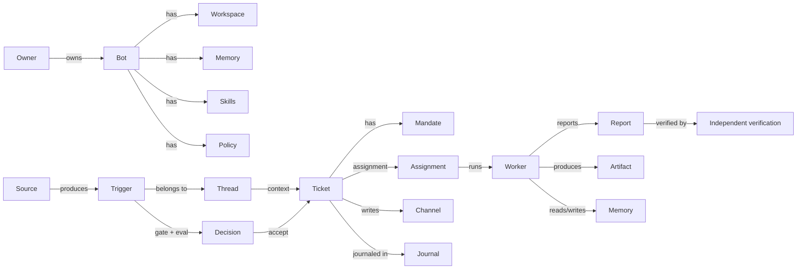

# 001 领域模型与术语

Status: normative  
Depends on: `000-thesis.md`  
Owns: 术语、实体、状态机、领域不变量  
Does not own: 实现细节（见 `002`–`007`）

本文件是**唯一的术语来源**。其他章节只能引用，不得重新定义。新增术语必须先加到这里。

## 1. 术语表

| 术语 | 中文 | 定义 | 所有者 |
|---|---|---|---|
| Owner | 所有者 | 拥有 Bot、授予权限、接收审批请求的人 | 本文 |
| Bot | 智能伙伴 | 长期实体：身份、人格、模型策略、权限、工作区、记忆域、技能、例程 | 本文 |
| Workspace | 工作区 | Bot 可读写的文件边界；每个 Ticket 可有独立子目录 | 本文 |
| Source | 来源 | 产生事件的系统：Web、IM、邮件、GitHub、CI、日程、Webhook | 本文 |
| Channel | 通道 | 可写回的地址：Web 会话、IM 会话、邮件、PR/Issue、通知 | 本文 |
| Conversation | 会话 | 人与 Bot 的一段连续对话；不是工作单元 | 本文 |
| Thread | 线程 | 同一话题/工单相关事件的时序集合 | 本文 |
| Trigger | 触发 | 一个不可变事件，属于一个或多个 Thread | 本文 |
| Gate | 准入 | 确定性第一层过滤：来源、身份、白名单、去重、预算 | 本文 |
| Eval | 评估 | 判断 Trigger 是否值得开新工作：Gate + 模型评估 | 本文 |
| Decision | 决定 | Eval 的输出：accept / ignore / stop / unavailable | 本文 |
| Ticket | 工单 | 一个被授权的、可追踪的工作单元 | 本文 |
| Mandate | 授权 | 工单的范围、强度、策略版本、来源身份；不可变，除非撤回/撤销 | 本文 |
| Assignment | 派工 | 一个 Ticket 与一个 Worker 实例的绑定 | 本文 |
| Worker | 执行器 | 在 Ticket 范围内执行工作的隔离会话/进程 | 本文 |
| Report | 报告 | Worker 向 Ticket 汇报的状态：progress / waiting / ready / blocked / failed / dropped | 本文 |
| Artifact | 工件 | 执行产生的文件、PR、消息、截图等可验证产物 | 本文 |
| Approval | 审批 | 人对不可逆动作/工单/技能/记忆写入的决定 | 本文 |
| Receipt | 收据 | 从 journal 重建的动作证明 | 本文 |
| Memory | 记忆 | 跨会话持久信息，分四层，见 `004-memory.md` | 本文 |
| UserModel | 用户模型 | 关于 Owner 的偏好、边界、项目、沟通风格的结构化记忆 | 本文 |
| Skill | 技能 | 可复用的流程知识，按需加载，带版本与评测 | 本文 |
| Routine | 例程 | 定时/条件触发的自动化工作模板 | 本文 |
| Policy | 策略 | 版本化的授权规则、白名单、准入表、执行策略 | 本文 |
| AuthorityProfile | 权限档案 | 一个 Bot/Ticket 的读、写、执行、网络、密钥、风险上限 | 本文 |
| Run | 运行 | 一次模型/工具执行链，落 journal | 本文 |
| Journal | 日志 | append-only、可重放的事实记录 | 本文 |
| Event | 事件 | journal 中的一条不可变记录 | 本文 |

## 2. 关系图



## 3. 状态机

### 3.1 Trigger

```text
received
  → filtered        （Gate 丢弃：来源/身份/白名单/去重/预算）
  → delivered       （已投递给订阅的 Ticket，作为上下文，不授权）
  → evaluating      （进入 Eval）
      → accepted    （创建 Ticket + Mandate）
      → ignored     （不创建工单，记录理由）
      → unavailable （评估失败/超时，可重试）
```

规则：

- Trigger 不可变；重复投递不产生第二个 Ticket（幂等键）。
- `delivered` 不等于授权；订阅只提供上下文。
- `filtered` 必须记录原因；不允许静默丢弃。

### 3.2 Ticket

```text
open
  → queued      （等待 Worker 槽位）
  → working     （有活跃 Assignment）
  → waiting     （Worker 等待 Trigger/时间/外部事件）
  → blocked     （需要人/外部条件）
  → failed      （不可自动恢复）
  → ready       （结果可审）
  → ended       （完成/停止/丢弃）
```

规则：

- 只有 Eval 的 accept 决定（经 `TicketStore`）或 Owner 能创建 Ticket。
- 一个 Ticket 同一时刻最多一个活跃 Assignment。
- `ended` 后保留 Mandate 与订阅；人的消息可 resume。
- 停止（stop）只能由 Owner 或策略撤回；Worker 不能声明"人要求停止"。
- 所有状态转换必须落 journal。

### 3.3 Assignment

```text
pending → running → ended
```

规则：

- 一个 Ticket 可以有多个 Assignment（重试/换 Worker）。
- Assignment 结束不自动结束 Ticket。
- 重试使用同一 Ticket、同一 Mandate；生成新的幂等键。
- Worker 崩溃 → `ended(failed)`，Ticket 进入 `failed` 或 `queued`（按策略）。

### 3.4 Mandate

```text
active → withdrawn（Owner 停止）
       → revoked （策略失效/再验证失败）
```

规则：

- Mandate 记录：Policy 版本、范围、强度（explicit/inferred）、来源身份、接收范围。
- Mandate 不可编辑；扩大范围必须新 Ticket。
- Resume 前必须再验证；失败则 Ticket 保持 ended，消息回到 Eval。
- Mandate 不能授予超出 Bot `AuthorityProfile` 的权限。

### 3.5 Memory candidate（经验/技能候选）

本节适用于经验/技能候选；Semantic 事实的写入策略见 `004-memory.md`，不走这条状态机。  
沿用 `docs/self-evolution.md`，不得重新定义：

```text
draft → reviewed → verified → approved | rejected
      → active → degraded | superseded | rolled_back
```

规则：

- `active` 必须来自 `approved` + 通过的 held-out 验证。
- 同一 kind + scope 只能有一个 `active`。
- 过期 `active` 是审计失败。
- 记忆写入默认需要 Approval（用户可配置为自动，仅限低风险类型）。

### 3.6 Skill

```text
draft → reviewed → verified → published
      → deprecated → retired
```

规则：

- Skill 是流程知识，不是事实；不得包含密钥、个人隐私、一次性事件叙事。
- Skill 版本不可变；修改生成新版本。
- 发布前必须过安全扫描（注入、凭据、隐藏字符）。
- Worker 只能加载已发布且 scope 匹配的 Skill。

### 3.7 Approval

```text
pending → approved | denied | expired
```

规则：

- 每个 Approval 绑定：动作摘要、范围、成本上限、过期时间、请求者。
- 不可逆动作必须有 Approval；可逆动作可按策略自动。
- Approval 一次性；重复使用视为越权。
- 过期未处理 → 动作不执行，Ticket 进入 `blocked`。

## 4. 领域不变量

1. **授权链完整**：Worker 的动作 ⊆ Ticket 的 Mandate ⊆ Bot 的 AuthorityProfile ⊆ Policy。
2. **单一声音**：Worker 不直接与 Owner 通信；所有对外消息经 Bot/Channel。
3. **记忆不授权**：Memory 只能提供上下文，不能改变权限、策略、工具白名单。
4. **状态可重建**：任何实体状态都能从 journal 事件重放。
5. **幂等**：同一 Trigger/Approval/Assignment 重复投递不产生重复副作用。
6. **边界封闭**：Artifact、Workspace、Skill 路径不得逃逸授权根。
7. **可停止**：任何长任务都能在安全点停止；不能停止的操作必须事先声明。
8. **可回滚**：记忆、技能、策略、工单状态都有回滚路径；不可回滚的动作必须审批。
9. **无隐式全局状态**：Bot 之间、租户之间默认隔离；共享必须显式授权。
10. **审计优先**：日志缺失视为失败，不得用模型自述补全。

## 5. 与当前实现的映射

| 1A Bot 概念 | 当前实现 | 差距 |
|---|---|---|
| Ticket | Master `WorkItem` | 需要事件入口、Mandate、人机通道 |
| Mandate | Master lease + plan approval | 需要范围/强度/策略版本/再验证 |
| Assignment | Workshop `agent-run` + lease | 需要每 Ticket 隔离目录、Worker 生命周期 |
| Report | `ExecutionReceipt` | 需要 progress/waiting/blocked 语义 |
| Artifact | 验收产物 + SHA-256 | 已有基础 |
| Approval | Master 审批 + HMAC envelope | 需要工具/技能/记忆级审批 |
| Memory (episodic) | journal | 需要索引与检索 |
| Memory (procedural) | experience store | 需要自动提案、效用、技能化 |
| Memory (semantic) | 无 | 全新 |
| UserModel | 无 | 全新 |
| Skill | experience content | 需要 SKILL.md 格式、版本、市场 |
| Policy | 启动参数 + config | 需要版本化、准入表、白名单 |
| Bot | 无（TUI 会话） | 全新 |
| Channel | TUI 输出 | 需要 Web/IM/邮件/PR |
| Source | 人输入 | 需要 Web/IM/Webhook/CI |

映射原则：**能复用就复用，不能复用就适配，不另起一套概念。**

## 6. 被拒绝的概念

| 被拒绝 | 理由 |
|---|---|
| 把 Session 当工作单元 | 会话会断、会换端；Ticket 才是工作身份 |
| 跨 Source 映射同一个人 | 身份由各 Source 自己给；映射是提示词/配置，不是领域实体 |
| Memory 作为权限来源 | 记忆是数据，不是授权 |
| 一个全局共享记忆池 | 泄漏与污染；必须按 Bot/Workspace/Scope 隔离 |
| Worker 直接回复用户 | 破坏单一声音与授权链 |
| 用模型自述代替 journal | 不可审计 |
| 无限制的自主循环 | 必须有预算、停止条件、人工闸门 |
| 把 Skill 当事实 | 技能是流程，不是证据 |

## 7. 命名约定

- 领域实体用单数：`Ticket`、`Mandate`、`Assignment`。
- 事件用过去式：`TicketCreated`、`MandateWithdrawn`、`ReportReady`。
- 状态用小写蛇形：`waiting`、`blocked`、`ready`。
- API 字段用 snake_case；JSON 契约 `deny_unknown_fields`。
- 中文界面用术语表的中文；英文技术名保留在括号中。

## 8. 术语变更流程

1. 在本文新增/修改术语。
2. 搜索全仓库引用，列出受影响文档与代码。
3. 开 ADR（见 `010-governance.md`），说明迁移与兼容。
4. 更新 API/JSON schema 与测试。
5. 在 `010-governance.md` 记录决策。

未完成以上步骤，不得在代码或文档中使用新术语。
